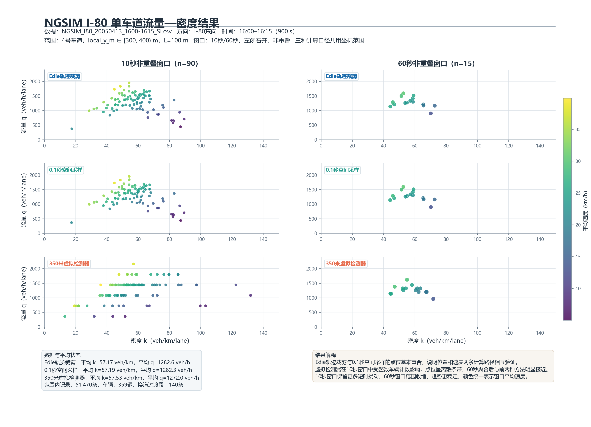
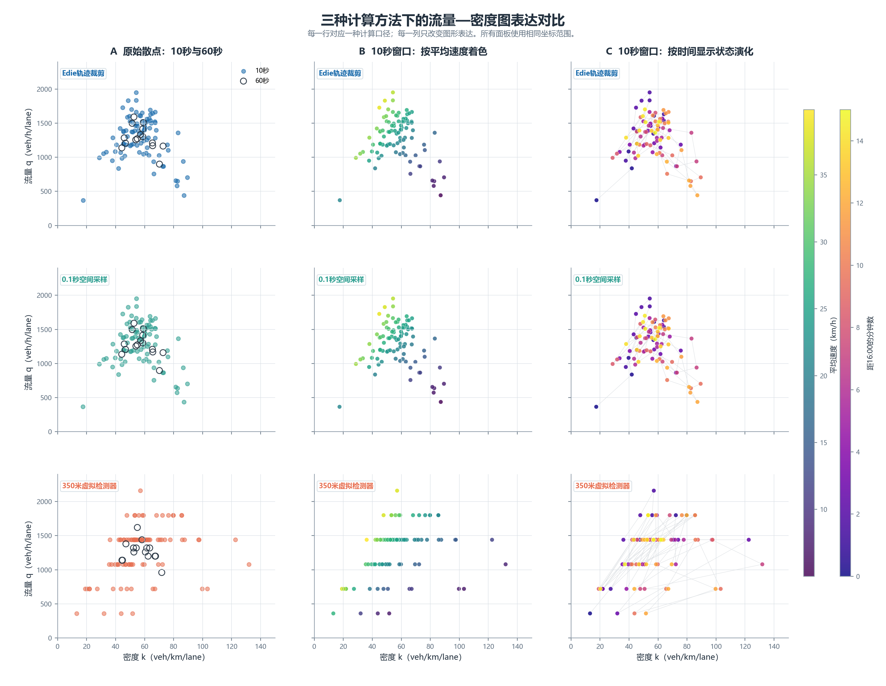

# NGSIM I-80 单车道流量—密度基本图

本项目使用 NGSIM I-80 车辆轨迹，固定东向4号车道与100 m路段，分别用10秒和60秒非重叠窗口计算流量、密度和速度。实验并行采用三种计算口径，比较它们在短窗口和长窗口下的结果差异，再用三种图形表达检查点云结构、速度状态与时间演化。



## 1. 分析范围

| 项目 | 设置 |
|---|---|
| 数据 | NGSIM I-80，2005-04-13 16:00–16:15 |
| 方向 | I-80东向 |
| 车道 | `lane_id = 4` |
| 纵向范围 | `local_y_m ∈ [300, 400)` m |
| 路段长度 | `L = 100 m` |
| 虚拟检测器 | `local_y_m = 350 m` |
| 时间范围 | `time_s ∈ [0, 900)` s |
| 聚合窗口 | 10秒、60秒，左闭右开且非重叠 |

选择4号车道是为了避开1号快速车道、6号外侧车道以及只覆盖局部路段的7号辅助车道。300–400 m位于观测区间内部，远离数据首尾边界，并且90个10秒窗口和15个60秒窗口均有车辆覆盖。该范围包含51,470条轨迹记录和359辆不同车辆，既有较高流量状态，也有低速高密度状态，适合比较流量—密度关系。

## 2. 数据处理逻辑

脚本不修改原始CSV，主要处理步骤如下：

1. 读取车辆编号、时间、纵向位置、车道、速度等字段。
2. 按 `vehicle_id` 和 `time_s` 排序，构造相邻0.1秒轨迹段。
3. 统计重复车辆—帧键和关键字段缺失；构造轨迹段时仅使用时间间隔不超过0.1秒且纵向位置不倒退的相邻点。
4. 固定4号车道和300–400 m路段。
5. 对换道过渡段采用保守口径：只有相邻两点都属于4号车道时，才把该轨迹段计入Edie法或虚拟检测器法。
6. 分别构造10秒和60秒非重叠窗口。
7. 用三种方法计算每个窗口的密度、流量和平均速度。
8. 检查6个连续10秒窗口聚合后是否与对应60秒窗口一致。
9. 导出逐窗口CSV、分析摘要和两组图形。

时间窗口统一使用左闭右开形式，例如 `[0,10)`、`[10,20)`，避免边界记录重复计数。空间范围同样使用 `[300,400)` m。

## 3. 三种计算方法

### 3.1 Edie轨迹裁剪

Edie法把“100 m路段 × 时间窗口”看成一个时空区域。每辆车的相邻轨迹点之间采用线性运动假设，并将轨迹段裁剪到该时空区域内。

设车辆在区域内的实际停留时间为 `Δt_i`，实际行驶距离为 `Δd_i`，则：

```text
k = ΣΔt_i / (L × T) × 1000       veh/km/lane
q = ΣΔd_i / (L × T) × 3600       veh/h/lane
v = q / k                         km/h
```

这种方法能处理车辆在窗口中途进入或离开路段的情况，是本实验最直接的轨迹时空测量方法。

数据最后一个采样时刻为899.9秒。对于仍在观测区内的车辆，脚本根据最后速度外推0.1秒，用于闭合 `[899.9,900.0)` 区间。

### 3.2 0.1秒空间采样

每0.1秒统计一次100 m路段内的车辆数和速度。对时刻 `t`：

```text
k_t = N_t / L × 1000
u_t = 路段内车辆速度算术平均值 × 3.6（km/h）
q_t = k_t × u_t
```

再对窗口内所有0.1秒时刻的 `k_t` 和 `q_t` 求平均。这是Edie定义的离散近似，但它使用数据中的 `speed_m_s`，而Edie法主要使用位置变化，所以两者可以相互校核。

### 3.3 350 m虚拟检测器

在 `local_y_m = 350 m` 设置虚拟断面。车辆相邻轨迹点跨越该位置时，线性插值得到穿越时间与穿越速度。

```text
q = N_cross / T × 3600
u = 穿越速度的调和平均值
k = q / u
```

这种方法模拟单点检测器。10秒窗口内通常只有少量车辆通过，因此流量以360 veh/h为一个计数台阶，短窗口点云比路段法更离散。

## 4. 主要结果

### 4.1 Edie法的窗口范围

| 窗口 | 样本数 | 密度范围（veh/km/lane） | 流量范围（veh/h/lane） | 速度范围（km/h） |
|---|---:|---:|---:|---:|
| 10秒 | 90 | 17.58–89.47 | 369.89–1950.44 | 5.07–38.52 |
| 60秒 | 15 | 44.29–72.73 | 899.12–1589.90 | 12.80–30.22 |

10秒窗口保留车辆到达、启停和局部扰动，点云覆盖更广。60秒窗口对短时波动进行了平均，因此密度、流量和速度范围均明显收缩。

### 4.2 三种方法的15分钟平均状态

| 方法 | 平均密度（veh/km/lane） | 平均流量（veh/h/lane） |
|---|---:|---:|
| Edie轨迹裁剪 | 57.17 | 1282.64 |
| 0.1秒空间采样 | 57.19 | 1282.34 |
| 350 m虚拟检测器 | 57.53 | 1272.00 |

三种方法对15分钟平均交通状态的判断一致。Edie法与空间采样法几乎重合；虚拟检测器的平均值也接近，但逐窗口波动更大。

### 4.3 方法一致性

| 方法对比 | 窗口 | 密度MAE（veh/km） | 流量MAE（veh/h） |
|---|---:|---:|---:|
| Edie vs 空间采样 | 10秒 | 0.089 | 3.36 |
| Edie vs 空间采样 | 60秒 | 0.038 | 1.30 |
| Edie vs 虚拟检测器 | 10秒 | 10.59 | 163.98 |
| Edie vs 虚拟检测器 | 60秒 | 3.31 | 47.06 |

Edie法与空间采样法的误差很小，说明位置轨迹和速度字段给出了高度一致的结果。虚拟检测器在10秒窗口下受整数车辆计数影响较强，延长到60秒后误差明显下降。

6个连续10秒Edie窗口聚合到对应60秒窗口时，密度与流量的最大差值均为0，说明窗口边界和单位换算保持一致。

## 5. 可视化与解释

### 5.1 一页结果图

`results/summary.png` 使用3行×2列的小多图：

- 行：Edie轨迹裁剪、0.1秒空间采样、350 m虚拟检测器；
- 列：10秒窗口、60秒窗口；
- 所有面板使用相同横纵坐标；
- 点的颜色统一表示窗口平均速度。

这张图负责比较计算方法和聚合窗口，是最终结果汇报图。它显示Edie法与空间采样法形态近乎一致；虚拟检测器的10秒结果呈离散条带，60秒结果则明显向前两种方法收敛。

### 5.2 图形表达对比



`results/visualization_comparison.png` 使用3行×3列：每一行对应一种计算方法，每一列对应一种表达方式。

- A 原始散点：叠加10秒实心点和60秒空心点，直接比较聚合尺度。
- B 速度着色：用10秒窗口，颜色表示 `v=q/k`，用于识别高速低密度和低速高密度状态。
- C 时间演化：用10秒窗口，按时间着色并连接相邻窗口，用于观察15分钟内状态迁移。

三列只改变图形表达，不改变计算结果。原始散点最适合保留证据，速度着色最适合解释交通状态，时间演化图适合查找拥堵形成、消散和可能的滞回路径。

## 6. 结果解释

1. 研究时段主要处于中高密度状态，局部窗口出现低速高密度和流量下降。
2. 10秒窗口适合观察短时扰动，但点云更分散；60秒窗口适合呈现稳定趋势，但会掩盖快速变化。
3. Edie法和空间采样法高度一致，说明轨迹裁剪与速度积分均可靠。
4. 虚拟检测器不是“算错”，而是测量对象不同：它测量固定断面的车辆通过，而前两种方法测量100 m路段的时空平均状态。
5. 单车道100 m短路段中，10秒断面流量容易受到少量车辆的整数计数影响，因此不宜仅凭短窗口虚拟检测器点云判断容量或基本图形状。

## 7. 运行方法

需要 Python 3.10 或更新版本。安装依赖：

```bash
python -m pip install -r requirements.txt
```

原始数据不提交到GitHub。将 `NGSIM_I80_20050413_1600-1615_SI.csv` 放入项目的 `data/` 目录：

```text
week04/
├─ analysis.py
├─ README.md
├─ requirements.txt
├─ data/
│  └─ NGSIM_I80_20050413_1600-1615_SI.csv   # 不提交到GitHub
└─ results/
   ├─ summary.png
   ├─ visualization_comparison.png
   ├─ window_results.csv
   └─ analysis_summary.txt
```

运行：

```bash
python analysis.py
```

脚本也兼容当前课程文件结构：如果 `data/` 中没有CSV，会继续查找项目上一级目录中的 `第4周_NGSIM-I80_课堂数据/NGSIM_I80_20050413_1600-1615_SI.csv`。

主要输出：

- `results/summary.png`
- `results/visualization_comparison.png`
- `results/window_results.csv`
- `results/analysis_summary.txt`

## 8. 数据来源

数据来源：U.S. Department of Transportation，NGSIM I-80 trajectory data。

官方入口：<https://data.transportation.gov/d/8ect-6jqj>

项目使用课程提供的SI版本，距离单位为米，时间单位为秒。原始数据不包含在本仓库中。
