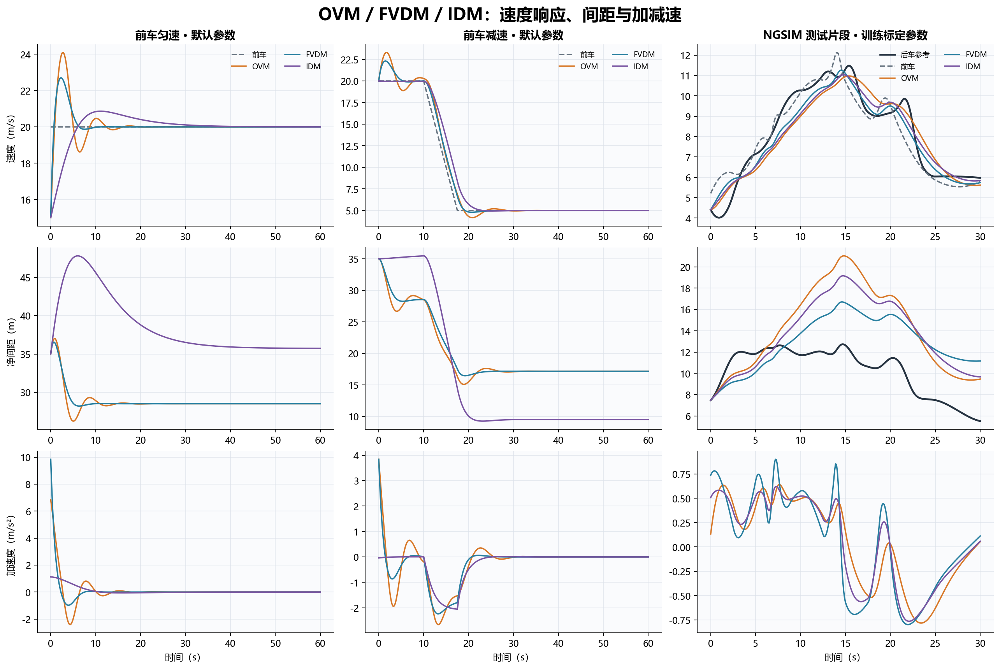
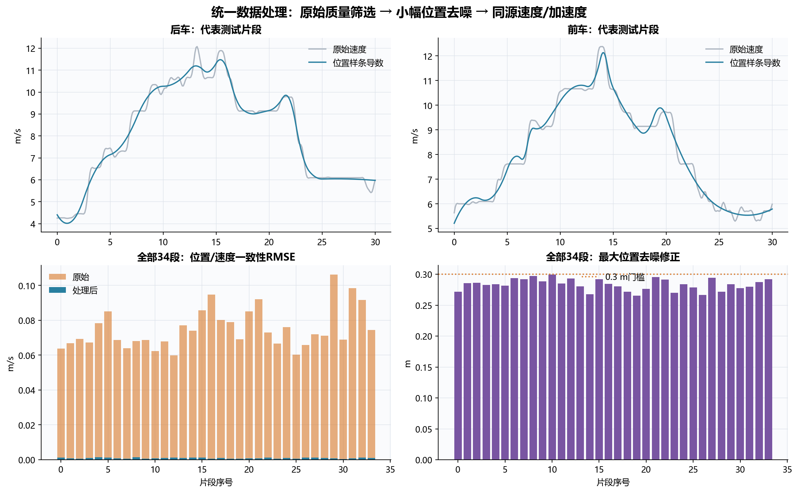
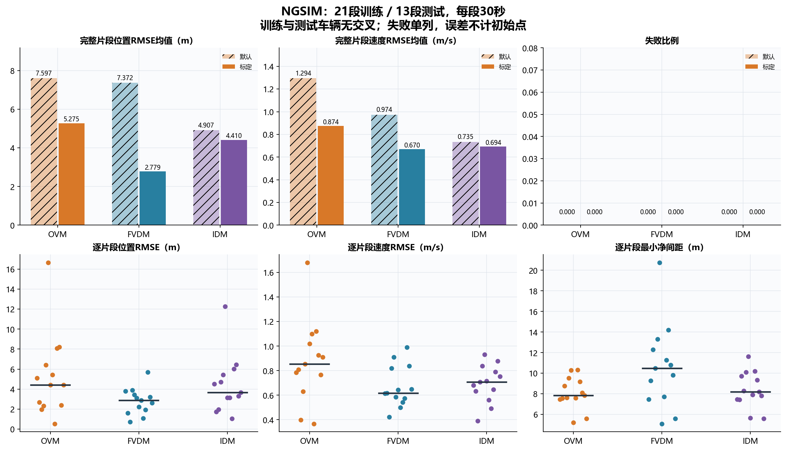
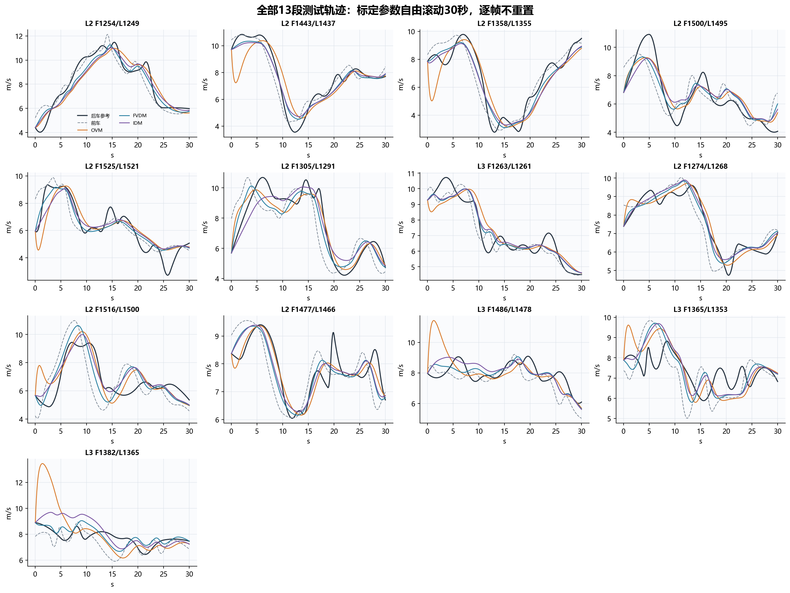
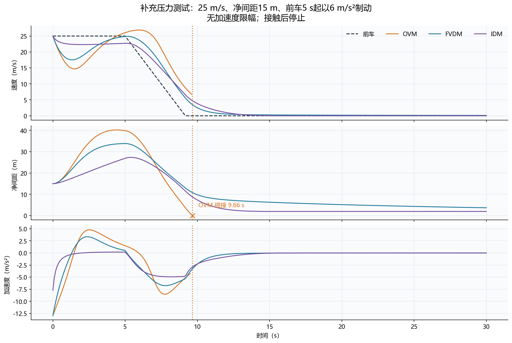

# OVM、FVDM、IDM：高质量NGSIM片段的复现与比较

本项目完成前车匀速、前车减速与NGSIM真实跟驰三组共同实验，另加紧急制动压力测试。真实实验固定使用已筛选的**21段训练、13段测试，每段30秒**；所有片段采用相同处理，训练/测试前后车编号无交叉。当前结果替代之前未经充分质量筛选的版本和单片段版本。仓库目录为 `week05/`，包含筛选数据、全部结果及压缩的原始公开数据，可独立复现。



## 1. 数据与范围

数据来自week4课程NGSIM I-80 SI文件，2005-04-13当地时间16:00–16:15。**week4保持只读，所有筛选、去噪和输出均在week5。** 本次采用较早时段内通过质量门槛的2–5号车道片段，不局限于week4的4号车道100米路段。

| 设置 | 内容 |
|---|---|
| 训练 | 21段，含缓冲的完整窗口结束≤250 s |
| 测试 | 13段，含缓冲的完整窗口开始≥300 s、结束≤500 s |
| 每段 | 30 s、301个0.1 s采样点，两端各5 s稳定跟驰缓冲 |
| 总评价时长 | 34×30=1020 s；训练630 s、测试390 s |
| 集合隔离 | 前车及后车编号交集为空；每位后车最多选1段 |
| 参数 | 理想实验用默认值；真实实验同时报告默认值与仅用21段训练标定的值 |

| 集合 | 车道 | 片段数 |
|---|---|---|
| test | 2 | 9 |
| test | 3 | 4 |
| train | 2 | 10 |
| train | 3 | 4 |
| train | 4 | 3 |
| train | 5 | 4 |

候选车道有2–5号，但测试样本主要落在2、3号车道，不能将测试结果称作所有车道均衡比较。筛选偏向稳定纵向跟驰，结论限于这一子集。

## 2. 为什么重新筛选，如何处理

NGSIM可以用于跟驰研究，问题是不能直接把未经检查的微观信号作为真实驾驶响应。上一版50段中37段存在相邻0.1秒速度差折算的加速度绝对值超过6 m/s²，极端值约158 m/s²。之前只凭同车道和前车不变，质量筛选不足。这个问题不能直接推翻week4的聚合基本图分析，二者关注的尺度不同。

本次在模型运行前固定以下观察数据门槛，不按拟合误差、碰撞或模型排名挑样本：

1. 同帧、同车道按纵向位置确定最近前车，先找前车再筛车型。源文件缺少前车编号，因此仍是几何推断。
2. 两车均为小汽车，车长3–6 m；前车编号与车道在40秒完整窗口内不变，连续0.1秒采样；评价中间30秒，前后各留5秒缓冲。
3. 原始净间距2–60 m；原始速度差分加速度绝对值≤6 m/s²；前后车位置—速度一致性RMSE均≤0.15 m/s，99%绝对误差≤0.6 m/s。
4. 去除固定道路曲率后，单车横向残差跨度≤1.5 m，两车横向残差差≤1.5 m。道路中心线由按纵向位置分箱的横向中位数拟合，仅描述固定几何，不拟合跟驰行为。
5. 后车均速≥2 m/s，移动时中位净时距≤4 s；至少一辆车速度变化范围≥2 m/s，保留动态信息。
6. 对40秒位置分别拟合三次平滑样条，残差预算`N×(0.1 m)²`；从同一样条求速度/加速度，最后去掉缓冲。不用三个跟驰模型重建观测数据。
7. 最大位置修正>0.3 m、速度修正RMSE>0.3 m/s、加速度>5 m/s²、jerk绝对值95%分位>5 m/s³或出现负速度时淘汰，不做强制截断。

共审计3630个候选窗口，58个通过质量筛选。候选允许重叠，不能当成独立样本。按原有车道/时间覆盖规则和每位后车最多一段选出固定21/13段；没有继续扩大数据搜索或为增加数量降低质量门槛。各阈值为本项目教学设置，完整配置见[data/selection_config.json](data/selection_config.json)。

所选片段原始位置—速度一致性RMSE最大0.1062 m/s；统一处理后最大0.00141 m/s；最大位置修正0.299 m，处理后最大加速度3.935 m/s²。原始列与处理列一起保存在`following_observations.csv`，每个候选的通过/拒绝原因见`candidate_quality.csv`。

本次使用的是**本地筛选并做小幅去噪的课程NGSIM**，不是作者发布的Montanino–Punzo重建数据，也不声称复现其完整重建算法。作者重建数据入口本次返回403，没有使用未取得的数据。数据质量处理和换道/短片段剔除有[研究依据](https://arxiv.org/abs/1610.03124)；不能据此声称这些本地处理轨迹就是无误差真值。



## 3. 模型、共同实验与指标

净间距`s=x_L-x-L_L`，使用前车车长。OVM：`dv/dt=kappa[V(s)-v]`；FVDM另加`lambda(v_L-v)`；IDM使用自由加速与动态期望间距。OV曲线采用量纲化归一化tanh，IDM采用非负动态间距项；属于核心动力学教学复现，并非原论文逐图复制。公式、符号和单位见[模型说明](docs/model_equations.md)。

| 场景 | 输入 |
|---|---|
| 匀速 | 前车20 m/s、后车初速15 m/s、净间距35 m、60 s |
| 减速 | 双方初速20 m/s、净间距35 m，前车10–17.5 s以2 m/s²减至5 m/s，持续60 s |
| 真实跟驰 | 每段只用真实后车起点初始化，随后自由滚动30 s；前车回放，逐帧不重置后车 |
| 压力测试 | 双方初速25 m/s、净间距15 m，前车5 s起以6 m/s²制动到停，持续30 s |

默认自由速度均为30 m/s。OVM/FVDM共用`kappa=0.6 s⁻¹,h=25 m,ell=10 m`，FVDM另有`lambda=0.6 s⁻¹`；IDM：`a=1.2,b=2 m/s²,T=1.5 s,s0=2 m,delta=4`。相同初始条件不等于各模型都处于平衡状态。

真实实验仅用21段训练共同标定一个参数集，每模型两个固定初值、有界最小二乘。联合残差为位置误差/10 m和速度误差/2 m/s，不计初始点。13段测试不参与参数选择；原始与处理数据均保留，三个模型采用完全相同输入。参数及优化状态见[parameters.json](results/parameters.json)，表格见[calibrated_parameters.csv](results/calibrated_parameters.csv)。局部优化不保证全局最优；OVM有4个可调参数，FVDM/IDM各5个。

积分为弹道法，内部0.05 s，另以0.025 s核查。前车位置/速度在0.1秒采样点间分别线性插值，子步并非严格同一样条；处理后的采样点运动学一致性和积分敏感性分别核对。后车步内停止用精确停止距离，不倒车；不加速度限幅、不强制拉开间距，碰撞立即停止，后续NaN。

速度响应比较曲线、相对前车的速度RMSE和稳定时间（进入±0.5 m/s且直到结束不离开，减速从17.5 s算起）。真实RMSE先逐段计算，再对完整成功片段等权平均，初始点剔除。失败不计算完整RMSE，部分时长误差单列。净间距误差与后车位置误差只差符号，RMSE相同。`|a|>8 m/s²`单列强加减速诊断，不等同碰撞。

## 4. 主要结果

### 4.1 匀速与减速

| 场景 | 模型 | 状态 | 稳定时间 s | 最小净间距 m | 速度响应RMSE m/s |
|---|---|---|---|---|---|
| constant | OVM | success | 8.000 | 26.248 | 0.853 |
| constant | FVDM | success | 5.300 | 28.214 | 0.589 |
| constant | IDM | success | 18.300 | 35.000 | 0.876 |
| braking | OVM | success | 4.900 | 15.080 | 0.900 |
| braking | FVDM | success | 0.900 | 16.445 | 0.707 |
| braking | IDM | success | 3.100 | 9.256 | 1.114 |

这组默认设置下FVDM稳定更快、OVM超调较明显，IDM匀速追赶较缓。FVDM匀速追赶初始加速度更大，速度差项也可能放大加速。IDM减速场景间距较小，不是所有工况都更保守。

### 4.2 13段真实测试

| 参数 | 模型 | 成功/13 | 碰撞 | 数值失败 | 位置RMSE m | 速度RMSE m/s | 最小净间距 m |
|---|---|---|---|---|---|---|---|
| default | OVM | 13 | 0 | 0 | 7.597 | 1.294 | 5.591 |
| default | FVDM | 13 | 0 | 0 | 7.372 | 0.974 | 5.591 |
| default | IDM | 13 | 0 | 0 | 4.907 | 0.735 | 5.591 |
| calibrated | OVM | 13 | 0 | 0 | 5.275 | 0.874 | 5.207 |
| calibrated | FVDM | 13 | 0 | 0 | 2.779 | 0.670 | 5.088 |
| calibrated | IDM | 13 | 0 | 0 | 4.410 | 0.694 | 5.591 |

标定后位置误差最低为FVDM（2.779 m），速度误差最低为FVDM（0.670 m/s）。该判断限于这13段、参数范围和联合损失；没有显著性检验，不视作普遍排名。

三个标定模型共同成功片段的同样本比较：

| 模型 | 共同成功段数 | 位置RMSE m | 速度RMSE m/s |
|---|---|---|---|
| FVDM | 13 | 2.779 | 0.670 |
| IDM | 13 | 4.410 | 0.694 |
| OVM | 13 | 5.275 | 0.874 |

保持同一前车回放与同一预测，另对未经去噪的原始后车信号核对，避免只对平滑参考打分：

| 模型 | 对原始位置RMSE m | 对原始速度RMSE m/s |
|---|---|---|
| OVM | 5.279 | 0.920 |
| FVDM | 2.785 | 0.726 |
| IDM | 4.414 | 0.747 |





一页图代表片段按测试中实测后车速度变化幅度最大选取：`L2_F1254_L1249_003083`；未按模型效果挑图。另展示全部13段测试轨迹，避免只看一个案例。

### 4.3 失败与数值敏感性

真实实验失败明细（空表表示未发生）：

| 片段 | 集合 | 参数 | 模型 | 状态 | 失败时刻 s |
|---|---|---|---|---|---|

压力测试：

| 模型 | 状态 | 失败时刻 s | 最小净间距 m | 最大|a| m/s² |
|---|---|---|---|---|
| OVM | collision | 9.661 | 0.000 | 12.961 |
| FVDM | success | — | 3.713 | 12.961 |
| IDM | success | — | 1.985 | 7.700 |



压力测试初态不是所有模型的平衡状态，初始强制动不能全解释为前车制动响应；没有现实制动限幅，未碰撞不等于现实安全保证。全部213项步长减半核查中失败类型改变0项；共同有效时刻最大位置差0.146 m、速度差0.085 m/s。逐项见[步长核查](results/step_size_check.csv)。

标定触边参数：OVM.v0=15.000, OVM.kappa=2.000, OVM.h=5.000, FVDM.v0=15.000, FVDM.kappa=0.100, FVDM.h=5.000, IDM.v0=15.000, IDM.b=0.500。这些参数可能辨识不足或相互补偿，不能直接当成驾驶员精确物理属性。误差目标也不包含独立安全裕度约束。

## 5. 最终判断与优缺点

| 模型 | 能反映的内容 | 优点 | 缺点 |
|---|---|---|---|
| OVM | 间距决定目标速度，车辆松弛调整 | 简单、快，易解释超调与振荡 | 不直接使用速度差，可能强加减速或碰撞 |
| FVDM | 间距反馈加双向速度差反馈 | 能直接响应相对运动，适合展示速度差信息的作用 | 多一个参数，线性项可放大加速度，不保证安全距离 |
| IDM | 自由加速、期望时距、静止间距与接近速度共同制动 | 参数含义直观，连接自由行驶与跟驰 | 非线性参数可能互相补偿，小间距可产生强制动，依赖数值与物理约束 |

**判断**：速度响应更快、轨迹误差更小和安全裕度更大是不同证据，需要同时看。此次改进重点是先剔除不适合纵向跟驰的噪声/换道附近片段，再作公平比较；不通过挑模型表现好的轨迹来得到结论。21/13段比单段更能看到个体差异，但仍属于一个时段的精选子集，不能验证交通流串稳定性、拥堵波、容量或换道行为。

## 6. 输出与复现

```bash
python -m pip install -r requirements.txt
python run_experiments.py
python -m unittest discover -s tests -v
python validate_results.py
```

需要Python 3.10或更新版本。在 `week05/` 中运行上述命令，脚本自动读取仓库附带的 `data/NGSIM_I80_20050413_1600-1615_SI.csv.gz`，无需解压或另外下载数据。也支持未压缩CSV或 `--data "完整CSV路径"`。完整运行包括固定规则选段、训练标定、全部评价、图表和README更新。原始数据只读，所有结果写入本目录。

| 文件 | 用途 |
|---|---|
| `results/episodes.csv` | 34段索引、前后车、车道、时间及质量指标 |
| `results/following_observations.csv` | 10,234点，原始和处理后信号同时保留 |
| `results/candidate_quality.csv` | 全部候选及逐段拒绝原因 |
| `results/ngsim_episode_metrics.csv` | 34段×两组参数×三个模型的完整记账 |
| `results/ngsim_summary.csv` | 训练/测试汇总 |
| `results/ngsim_predictions.csv` | 所有预测，失败后为NaN |
| `results/parameters.json` | 默认/标定值、边界与收敛记录 |
| `results/data_audit.json` | 来源哈希、筛选配置与统计 |
| `results/validation.json` | 独立误差重算与输出核查 |
| `results/week4_integrity.json` | week4运行前后文件哈希核对 |
| `data/NGSIM_I80_20050413_1600-1615_SI.csv.gz` | 完整课程SI源数据，gzip无损压缩，约26.24 MB |
| `data/package_manifest.json` | 压缩文件与解压内容的大小、SHA-256和来源 |

5张图分别为一页结果、数据质量、测试指标、全部测试轨迹和压力测试。GitHub目录沿用week4的组织方式，包含代码、图表、派生数据及压缩源数据；排除未压缩的大CSV、缓存与旧归档。`week4_integrity.json`记录本地实验时对原week4的核查；独立克隆没有相邻week4时不重复该本地核查。

## 7. 来源

数据：[U.S. DOT NGSIM](https://data.transportation.gov/d/8ect-6jqj)，课程SI文件SHA-256：`df86a98e490daba1bf6a2ff3a1ca2e346be1cf2bdaf66a037910b74f40695255`。

模型：[Bando et al., 1995](https://doi.org/10.1103/PhysRevE.51.1035)、[Jiang et al., 2001](https://doi.org/10.1103/PhysRevE.64.017101)、[Treiber et al., 2000](https://doi.org/10.1103/PhysRevE.62.1805)。筛选背景：[Kurtc & Treiber, 2016](https://arxiv.org/abs/1610.03124)；轨迹重建背景：[Montanino & Punzo, 2015](https://doi.org/10.1016/j.trb.2015.06.010)。本项目使用本地小幅去噪，不是后者发布的重建数据。
