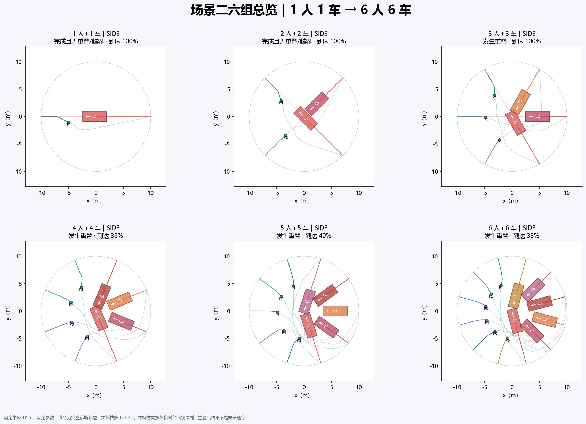
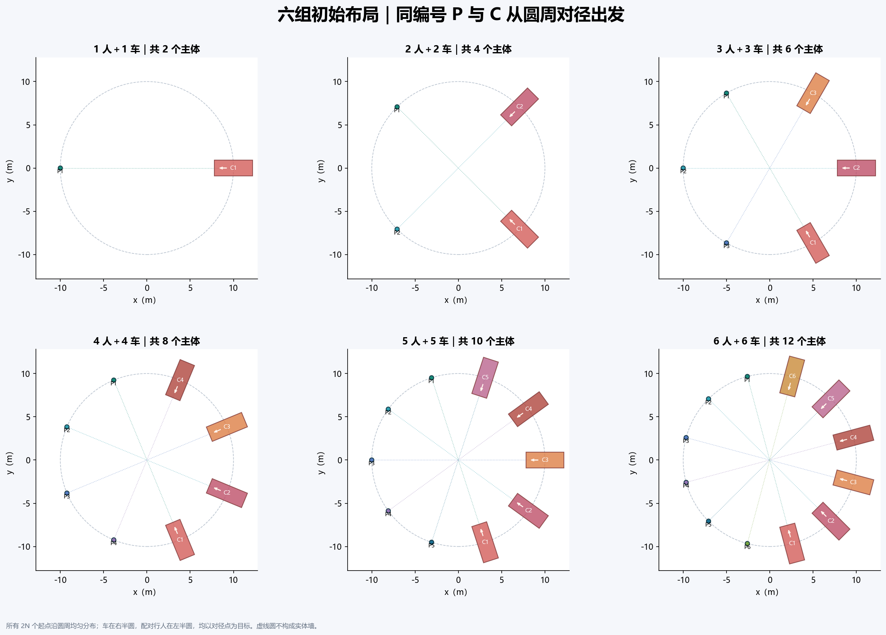
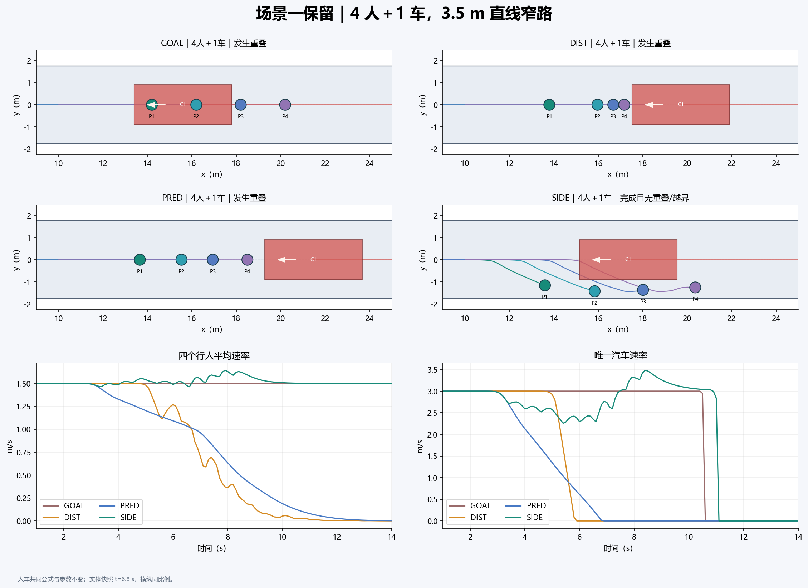
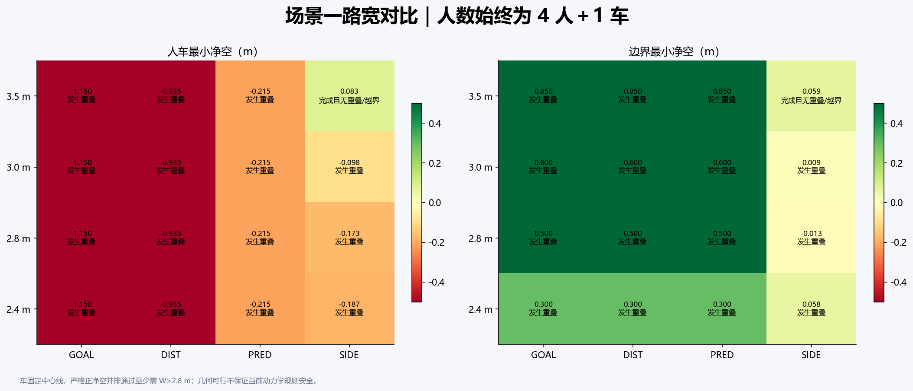
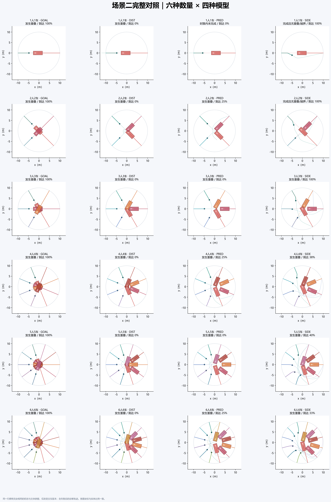
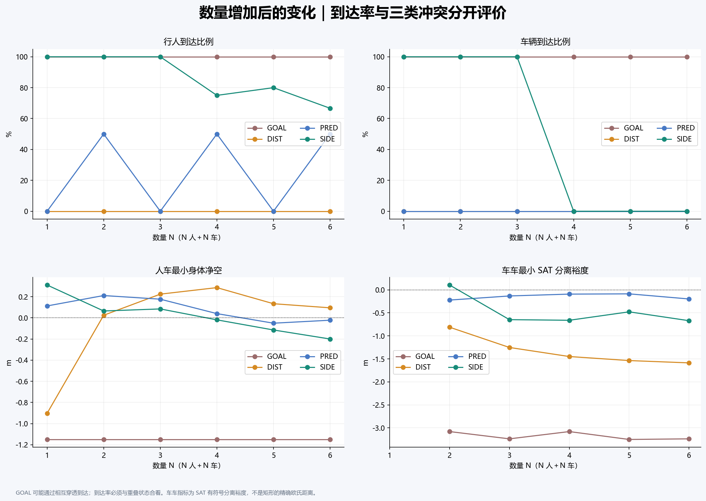
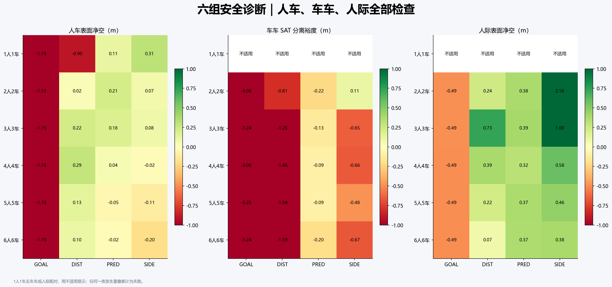
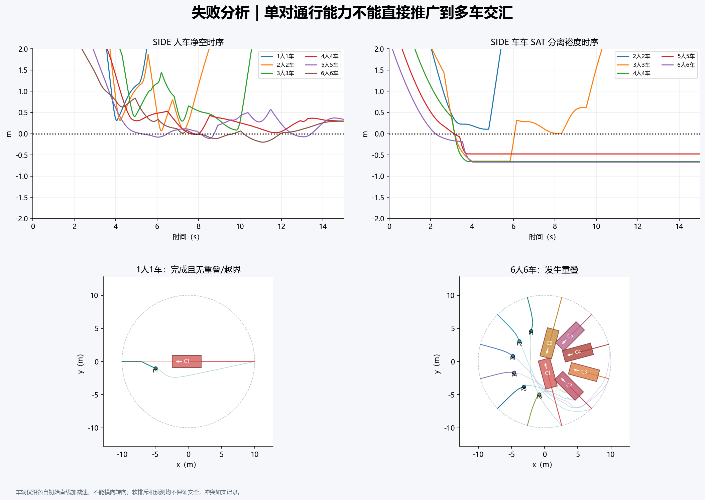
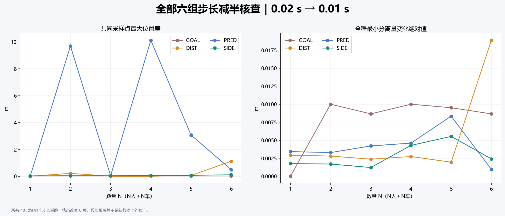

# Week 06：统一人车模型与六组圆周人车交会

**场景一保留 4 人＋1 车的 3.5 m 直线窄路；场景二完整实现 1人1车、2人2车、3人3车、4人4车、5人5车、6人6车六组。** 每组都运行 GOAL、DIST、PRED、SIDE 四种模型，共 24 个圆周对照；加上窄路四种宽度，共 40 个主实验。

每种模型内部，人和车共用目标驱动、交互与积分公式，尺寸、速度和自由度参数不同。此次补充了任意固定朝向的车辆矩形，以及车车交互和碰撞检测。多车不再全部当作沿全局 x 轴的单车。报告沿用 week5 的组织形式；仅修改 week6。



## 1. 场景、数据与范围

| 场景 | 行人数 | 车数 | 几何 |
|---|---:|---:|---|
| 场景一窄路 | 4 | 1 | 长40 m，主宽度3.5 m；另比较3.0、2.8、2.4 m |
| 场景二第1组 | 1 | 1 | 半径10 m，圆周对径目标 |
| 场景二第2组 | 2 | 2 | 同半径、同参数 |
| 场景二第3组 | 3 | 3 | 同半径、同参数 |
| 场景二第4组 | 4 | 4 | 同半径、同参数 |
| 场景二第5组 | 5 | 5 | 同半径、同参数 |
| 场景二第6组 | 6 | 6 | 同半径、同参数 |

圆周第 N 组：汽车起点角 theta_k=(k−(N−1)/2)·pi/N，k=0…N−1，在右半圆；对应行人位于汽车起点的相反点。所有 2N 个起点均匀分布在同一个圆上，各自目标为起点的负值。P1 对 C1，依次类推。没有圆形实体墙，也不是沿环形道路绕圈行驶。

每辆车沿自己的初始对径直线加减速，可停车、不倒车；在圆周实验中车辆朝向不相同，绘图与检测都使用真实朝向。没有增加自动转向或中途指定通行顺序。六组仅改变数量与由数量确定的均匀角度，半径和动力学参数保持固定。



全部为合成机制实验，初态可在 `data/scene_initial_conditions.json` 查看。当前不以旧的 64 人真实轨迹计算 ADE/FDE，不把它当成人车真实观测。历史版本仅在本地归档，未纳入本 GitHub 发布目录；当前 results 只包含最新的六组圆周交会与窄路结果。

## 2. 共同模型与参数

| 版本 | 共同机制 | 对照目的 |
|---|---|---|
| GOAL | 目标驱动＋道路边界，无主体避让 | 无交互基线 |
| DIST | GOAL＋当前净空排斥 | 距离反应 |
| PRED | DIST＋短时预测排斥 | 提前响应 |
| SIDE | PRED＋相对目标方向的右侧偏好 | 打破对称、产生绕行 |

这是三个递进的教学交互模型加一个无交互基线，不是四个独立论文算法的完整复现。公式详见 [模型说明](docs/model_equations.md)。共同参数仍为 A=5 m/s²、B=0.45 m、H=2 s、K=3.5 m/s²；边界 A=12 m/s²、B=0.15 m，没有按数量逐组调参。

| 参数 | 行人 | 汽车 |
|---|---:|---:|
| 身体 | 半径0.25 m圆 | 长4.4 m、宽1.8 m有向矩形 |
| 期望速度 | 1.5 m/s | 3 m/s |
| 响应时间尺度 | 0.5 s | 0.8 s |
| 加速度模长上限 | 3 m/s² | 4 m/s² |
| 自由度 | 平面运动 | 初始目标方向的直线运动 |

车辆将同一个加速度公式的输出投影到自身初始航向，速度同样投影并禁止倒车；不是给车另用跟驰模型。所有主体距离目标0.8 m内共同减速，进入0.25 m范围后停留并继续作为障碍。

## 3. 评价、车车几何与实验

圆—圆用欧氏表面净空，圆—有向矩形用局部坐标的精确有符号距离。**车—车采用分离轴定理 SAT：在两车的四个边法向上计算有符号分离裕度，取最大值。** 正值表示至少一个轴分离，负值表示所有轴重叠；其正值不是两矩形的精确欧氏最近距离，因此单独标注“车车 SAT 裕度”。所有几何都用于当前与预测交互，并用于实际重叠检测。

人车、人际、车车三类分别保存最小分离量，任一类重叠都判失败。`min_clearance_m` 是三类有符号分离量的最小值，只用于符号和安全诊断，不能当作统一的精确欧氏距离比较。单人单车不适用车车/人际指标，显示为空而非零。

成功要求全部主体到达、全程无重叠与越界。行人和车辆到达比例分别报告；`car_arrived` 表示所有车辆都到达。窄路错身要求全部行人越过唯一车尾；圆周错身要求每个行人沿其原直径方向完全越过自己的配对车尾。这个配对错身量是诊断，不能替代与其他车辆的安全检查。

40个主实验均运行40 s，内部dt=0.02 s、保存间隔0.1 s；全部40项用0.01 s重跑。窄路基础组和圆周六组的 SIDE 各做三个2 cm扰动种子，共21项。车辆初态扰动时目标同向平移，保持原固定航向。

发生重叠后仍继续的轨迹只作失效诊断，不把后续到达解读为安全成功；不强制拉开实体，不裁剪位置。首次失败按内部步记录，不是连续时间解析碰撞时刻。

## 4. 主要结果

### 4.1 场景一保留：4人1车、3.5 m窄路

| 模型 | 状态 | 人车净空 m | 人际净空 m | 全部错身 s |
|---|---|---|---|---|
| GOAL | collision | -1.150 | 1.500 | 7.700 |
| DIST | collision | -0.935 | -0.203 | — |
| PRED | collision | -0.215 | 0.100 | — |
| SIDE | success | 0.083 | 0.781 | 8.300 |





### 4.2 场景二六组 × 四模型完整结果

| 人数 | 车数 | 模型 | 状态 | 人车净空 m | 车车 SAT 裕度 m | 行人到达比例 | 车辆到达比例 |
|---|---|---|---|---|---|---|---|
| 1 | 1 | GOAL | collision | -1.150 | — | 1.000 | 1.000 |
| 1 | 1 | DIST | collision | -0.903 | — | 0.000 | 0.000 |
| 1 | 1 | PRED | timeout | 0.113 | — | 0.000 | 0.000 |
| 1 | 1 | SIDE | success | 0.311 | — | 1.000 | 1.000 |
| 2 | 2 | GOAL | collision | -1.150 | -3.080 | 1.000 | 1.000 |
| 2 | 2 | DIST | collision | 0.025 | -0.812 | 0.000 | 0.000 |
| 2 | 2 | PRED | collision | 0.211 | -0.222 | 0.500 | 0.000 |
| 2 | 2 | SIDE | success | 0.065 | 0.105 | 1.000 | 1.000 |
| 3 | 3 | GOAL | collision | -1.150 | -3.238 | 1.000 | 1.000 |
| 3 | 3 | DIST | collision | 0.225 | -1.252 | 0.000 | 0.000 |
| 3 | 3 | PRED | collision | 0.177 | -0.133 | 0.000 | 0.000 |
| 3 | 3 | SIDE | collision | 0.085 | -0.648 | 1.000 | 1.000 |
| 4 | 4 | GOAL | collision | -1.150 | -3.080 | 1.000 | 1.000 |
| 4 | 4 | DIST | collision | 0.286 | -1.449 | 0.000 | 0.000 |
| 4 | 4 | PRED | collision | 0.040 | -0.093 | 0.500 | 0.000 |
| 4 | 4 | SIDE | collision | -0.019 | -0.661 | 0.750 | 0.000 |
| 5 | 5 | GOAL | collision | -1.150 | -3.251 | 1.000 | 1.000 |
| 5 | 5 | DIST | collision | 0.134 | -1.537 | 0.000 | 0.000 |
| 5 | 5 | PRED | collision | -0.050 | -0.087 | 0.000 | 0.000 |
| 5 | 5 | SIDE | collision | -0.114 | -0.478 | 0.800 | 0.000 |
| 6 | 6 | GOAL | collision | -1.150 | -3.238 | 1.000 | 1.000 |
| 6 | 6 | DIST | collision | 0.095 | -1.587 | 0.000 | 0.000 |
| 6 | 6 | PRED | collision | -0.022 | -0.198 | 0.500 | 0.000 |
| 6 | 6 | SIDE | collision | -0.200 | -0.670 | 0.667 | 0.000 |







不要只按到达率排序：无避让版本可能靠穿透完成目标；预测/绕行版本也可能因车车冲突、相持或行人绕行不当失败。车辆固定航向时，多条路线都穿过中心，单对通行能力不能直接推广为多车安全通行能力。

### 4.3 失败与数值敏感性





全部40项步长减半后状态变化 **0** 项，共同采样点最大位置差 **10.122 m**。状态不变并不表示路径已收敛：部分多车预测模型的轨迹差异较大，不能只凭失败类别相同就认定数值稳定。这是数值敏感性检查，不是不同真实实验上的验证。21项位置扰动结果如下：

| 场景 | 人数 | 车数 | 扰动种子 | 状态 | 最小分离量 m |
|---|---|---|---|---|---|
| narrow | 4 | 1 | noise_2cm_seed_1 | success | 0.083 |
| narrow | 4 | 1 | noise_2cm_seed_2 | success | 0.085 |
| narrow | 4 | 1 | noise_2cm_seed_3 | success | 0.086 |
| circle | 1 | 1 | noise_2cm_seed_1 | success | 0.299 |
| circle | 1 | 1 | noise_2cm_seed_2 | success | 0.297 |
| circle | 1 | 1 | noise_2cm_seed_3 | success | 0.321 |
| circle | 2 | 2 | noise_2cm_seed_1 | success | 0.039 |
| circle | 2 | 2 | noise_2cm_seed_2 | success | 0.039 |
| circle | 2 | 2 | noise_2cm_seed_3 | success | 0.038 |
| circle | 3 | 3 | noise_2cm_seed_1 | collision | -0.466 |
| circle | 3 | 3 | noise_2cm_seed_2 | collision | -0.046 |
| circle | 3 | 3 | noise_2cm_seed_3 | collision | -0.455 |
| circle | 4 | 4 | noise_2cm_seed_1 | collision | -0.233 |
| circle | 4 | 4 | noise_2cm_seed_2 | collision | -0.216 |
| circle | 4 | 4 | noise_2cm_seed_3 | collision | -0.657 |
| circle | 5 | 5 | noise_2cm_seed_1 | collision | -0.506 |
| circle | 5 | 5 | noise_2cm_seed_2 | collision | -0.322 |
| circle | 5 | 5 | noise_2cm_seed_3 | collision | -0.227 |
| circle | 6 | 6 | noise_2cm_seed_1 | collision | -0.484 |
| circle | 6 | 6 | noise_2cm_seed_2 | collision | -0.532 |
| circle | 6 | 6 | noise_2cm_seed_3 | collision | -0.483 |

## 5. 判断与限制

当前重点是完整实现六组人车数量、用相同公式检查三类交互与失败，不能据此声称具有多车安全保证。模型没有驾驶转向、显式反应延迟、视线遮挡、硬接触动力学或通行优先权；车辆只能沿各自固定直线前进。软排斥加速度受限，仍可能重叠或停滞。右侧偏好是模型假设，没有真实人车数据标定或独立验证。

## 6. 输出与复现

本目录包含完整代码、9张结果图、同步动画、40项压缩轨迹与指标，可离线查看。GitHub上的HTML链接显示源文件；下载仓库后用浏览器打开 `results/replay.html` 即可播放，无需联网。历史归档、Python缓存和虚拟环境未上传。

```bash
python -m pip install -r requirements.txt
python run_experiments.py
python -m unittest discover -s tests -v
python validate_results.py
```

Python 3.10+，不依赖网络、外部数据或旧周代码；使用4个本地计算进程执行独立实验。`python reporting.py` 可从缓存结果重绘图表、动画与报告。

| 文件 | 内容 |
|---|---|
| [同步动画](results/replay.html) | 六组总览、六组分别选四模型、窄路切换、播放暂停、时间拖动 |
| `results/summary.png` | 六组SIDE结果总览 |
| `results/circle_layouts.png` | 六组初始位置、配对关系与车身朝向 |
| `results/circle_models.png` | 6×4完整圆周模型对照 |
| `results/circle_dynamics.png` | 数量与到达率、人车/车车分离量 |
| `results/circle_safety.png` | 人车、车车、人际三类热图 |
| `results/failure_analysis.png` | 六组时序与单对/多对失败对照 |
| `results/narrow_comparison.png` | 保留的窄路4人1车模型对比 |
| `results/width_comparison.png` | 窄路四种宽度 |
| `results/numerical_sensitivity.png` | 全部六组步长核查 |
| `results/experiment_metrics.csv` | 40项主实验完整记账 |
| `results/step_size_check.csv` | 40项半步长重复 |
| `results/robustness.csv` | 21项位置扰动 |
| `results/*.npz` | 所有主体的状态、尺寸及三类细步长分离量 |
| `data/scene_initial_conditions.json` | 每个实验的完整初态 |
| `results/parameters.json` | 固定参数与六组设置 |
| `results/validation.json` | 独立几何重算、人数车数与指标核查 |
| `results/reference_weeks_integrity.json` | 其他周只读完整性记录 |
